<p align="center"></p>

<p align="center">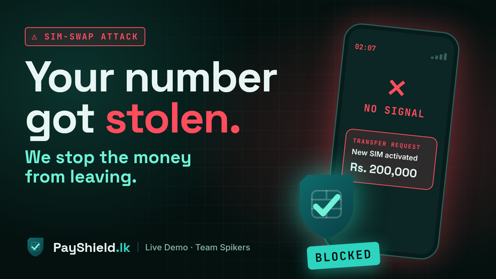</p>

> **A SIM swap is the moment a fraudster takes over a customer's phone number. PayShield.lk holds the money until the real customer answers on their own phone.**<br>
> *A telecom feed and a bank feed are read together. A fixed rule layer holds, blocks or releases the payment. The customer confirms with a live face scan and security questions. A language model writes the analyst's note. It never decides.*

**Pilot desk for SIM-swap fraud on Sri Lankan bank payments · demonstration bank: BankCylone (fictional)**

[](#version-information)
[](university-project/backend/requirements.txt)
[](#agentic-architecture)
[](university-project/frontend/package.json)
[](university-project/docker-compose.yml)
[](university-project/docker-compose.yml)
<br>
[](#qa-test-results)
[](#qa-test-results)
[](#qa-test-results)
[](#qa-test-results)
[](#policies-and-limitations)

[Demo video](https://www.youtube.com/watch?v=X6d-3UrnCWA) · [Live demo](#live-demo-and-how-it-is-served) · [See it work](#see-it-work) · [Features](#features) · [Agentic architecture](#agentic-architecture) · [Agent rules](#what-each-agent-may-and-may-not-do) · [Security](#security-controls) · [AI assistance](#ai-assistance) · [Benchmarks](#benchmark-results) · [QA](#qa-test-results) · [Business value](#business-value) · [Impact](#impact) · [Run it](#run-it)

<p align="center">
  <a href="https://www.youtube.com/watch?v=X6d-3UrnCWA"></a>
  <br><b><a href="https://www.youtube.com/watch?v=X6d-3UrnCWA">&#9654; Watch the demo video on YouTube</a></b>
</p>

> [!IMPORTANT]
> **Independent pilot. Not a bank product and not approved by any regulator.** Every person, balance and payment in the demo
> is fictional, and the telecom and bank feeds are simulated (the telecom feed has the same shape as the GSMA CAMARA SIM Swap API).
> Do not enter real personal or banking details.

---

## The problem

When a fraudster gets a SIM card issued in a victim's name, the bank's SMS codes and alerts go to the fraudster. The
payment looks like the customer's own, from a phone the bank trusts. Banks see the payment. Telecom operators see the
SIM change. Nobody sees both at the same time.

## What PayShield.lk does

| Step | What happens |
|---|---|
| 1. Read both feeds | A **Telecom agent** reads SIM-swap, handset, location and port-out signals. A **Banking agent** reads recent payments and compares the new payment with what is usual for that customer. They work in parallel. |
| 2. Score and decide | A **Risk agent** adds up the warning signs. A **Policy** layer, with no model in it, decides to **release**, **hold** or **block**. |
| 3. Ask the real customer | For a hold, the **Alert agent** asks "Did you make this payment?" in the customer's registered app. The SMS and email are generic, with no link and no code. |
| 4. Prove it is them | If the customer says yes, the **Verification agent** asks for a live face scan (look straight, turn left, turn right) and then rounds of security questions. |
| 5. Act | A pass releases the money. A fake face, failed answers, or a "No, this was not me" go to the **Response agent**, the only one that can block the payment, request a SIM freeze and lock the account. No answer in time goes to a human analyst, and the money stays held. |
| 6. Record | The **Report agent** checks every note against the facts and files a PDF incident report and a customer receipt. |

## Live demo and how it is served

The customer view is shared as a link on a **Cloudflare quick tunnel**. **The server is our own PC**: the backend,
database, Redis, the face matching and the AI calls all run in Docker on that machine, and the tunnel publishes it.

> [!NOTE]
> **The link only works while our server is on** (the PC, Docker and the tunnel are running). A quick tunnel creates a
> new address each time it starts, so an older link stops working. The address issued for the latest session was
> `https://qualities-state-solomon-document.trycloudflare.com/c` and is valid only until that tunnel is stopped.
> Start-up steps: [`docs/SHARE_ONLINE.md`](university-project/docs/SHARE_ONLINE.md).

The same stack also runs fully local at `http://localhost:3000` (fraud desk console) and `http://localhost:3000/c`
(customer site, built for phones).

## See it work

<table>
<tr>
<td width="25%" valign="top">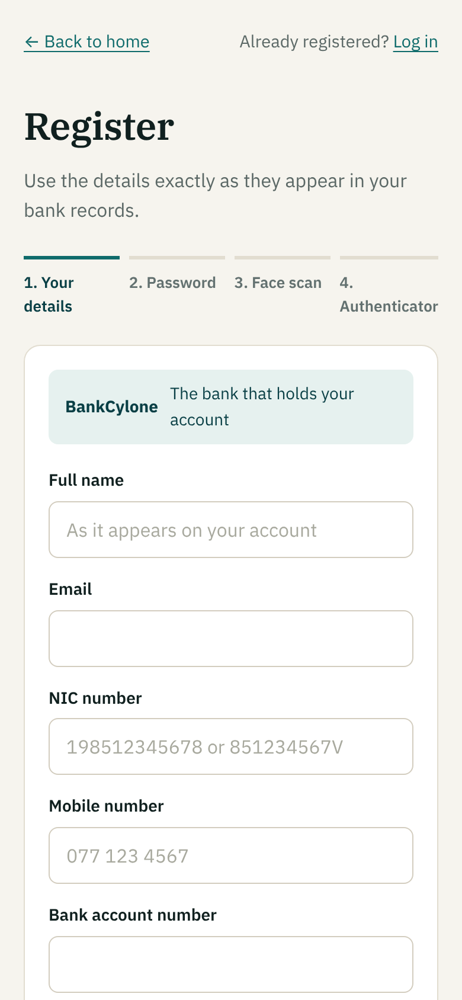<br><sub><b>Register</b>: details must match the bank's record.</sub></td>
<td width="25%" valign="top">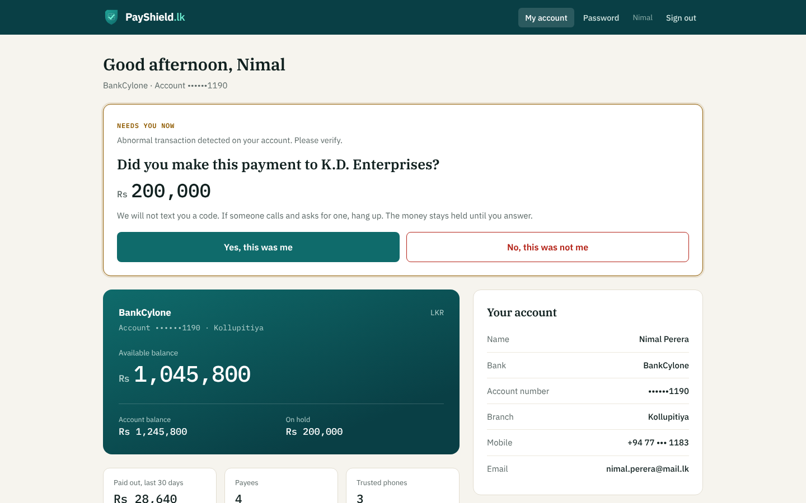<br><sub><b>The question</b>: "Did you make this payment?" The money stays held.</sub></td>
<td width="25%" valign="top">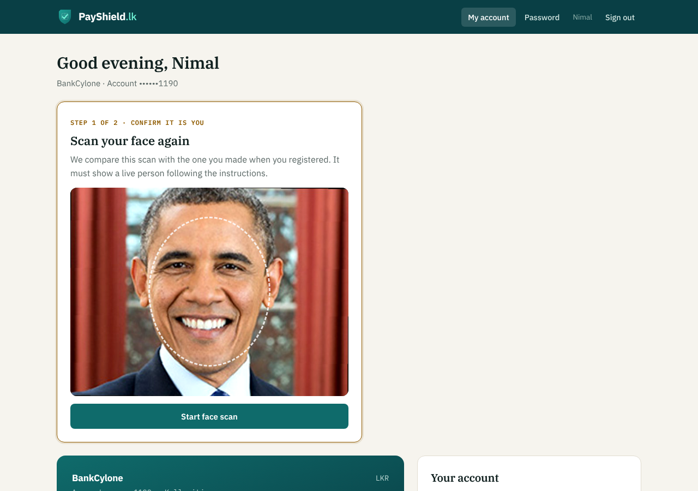<br><sub><b>Face scan</b>: straight, left, then right.</sub></td>
<td width="25%" valign="top">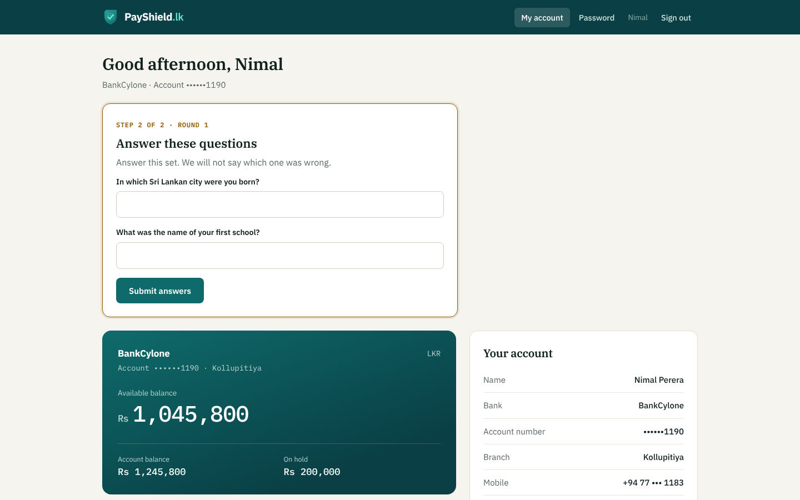<br><sub><b>Security questions</b>: three at a time.</sub></td>
</tr>
</table>

<table>
<tr>
<td width="50%" valign="top">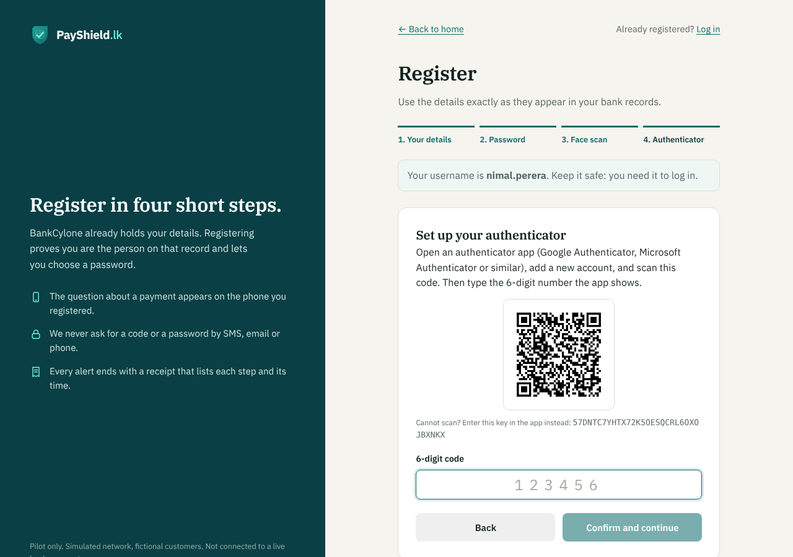<br><sub>Sign-in needs a 6-digit code from an authenticator app.</sub></td>
<td width="50%" valign="top">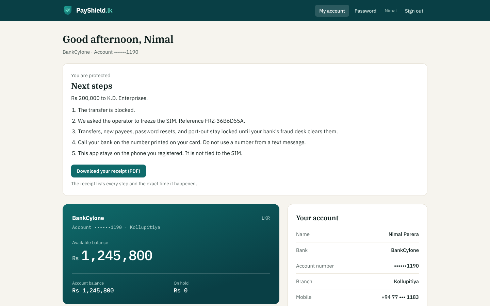<br><sub>After a block, the customer sees the outcome and must choose a new password.</sub></td>
</tr>
</table>

> The fraud desk console (live agent activity, cases, on-hold payments, reports, analytics map, simulate and demo controls)
> is described in [`docs/DEMO_GUIDE.md`](university-project/docs/DEMO_GUIDE.md).

## Sample inputs, outputs and reports

Four worked runs from the real workflow are in [`docs/samples/`](university-project/docs/samples/README.md): the input
(telecom feed, bank feed, payment, customer answers), the output (score, factors, rule decision, statuses, messages,
timeline) as JSON, and the **incident report PDF** for each case.

| Sample | Result | Files |
|---|---|---|
| Hold, then verified release (Rs. 200,000) | hold, then released | [JSON](university-project/docs/samples/01-hold-then-verified-release.json) · [PDF](university-project/docs/samples/01-hold-then-verified-release-incident-report.pdf) |
| Hold, then the customer denies | hold, then blocked | [JSON](university-project/docs/samples/02-hold-then-customer-denies-block.json) · [PDF](university-project/docs/samples/02-hold-then-customer-denies-block-incident-report.pdf) |
| Port-out critical (Rs. 800,000) | blocked at once | [JSON](university-project/docs/samples/03-port-out-critical-block.json) · [PDF](university-project/docs/samples/03-port-out-critical-block-incident-report.pdf) |
| Routine bill (Rs. 4,850) | released by the rules | [JSON](university-project/docs/samples/04-routine-payment-release.json) · [PDF](university-project/docs/samples/04-routine-payment-release-incident-report.pdf) |

## Features

**Fraud desk (operators and analysts)**
- **Live agent activity**: a flow view of every case, showing each agent, tool call, handoff and model note as it happens.
- **Cases and On hold**: filter by bank, province and risk; analysts can release or block held payments.
- **Reports**: a PDF incident report per case with a timeline and charts, plus a receipt for the customer.
- **Fraud analytics and Sri Lanka map**: payments counted by district, province and day.
- **Simulate and Demo controls**: raise a SIM swap and a payment on demand, plus drills (models down, delivery failing, a fraud spike, an agent crash, a silent customer, manual block switch).
- **Calibration**: an analyst proposes a change to the hold threshold; nothing changes until an analyst approves it.
- **Agents and models**: shows which model wrote each note and when the fallback was used.

**Customer site (mobile first)**
- Registration against the bank's own record, with a **live face scan**, an authenticator app and a chosen username and password.
- Sign-in with username, password and a 6-digit authenticator code. The password alone never opens a session.
- Account summary and transactions, the payment question, **face verification** and **security questions**, and a forced password change after any alert.
- Live updates over a WebSocket, backed by a refresh every four seconds.

**Alerts**
- In-app push and WebSocket, **SMS** (Text.lk driver) and **email** (SMTP driver). In demo mode, messages go only to numbers and addresses on an allow-list.
- SMS and email are generic. A message with a link or a code is refused by the system itself.

**Platform**
- **Meta** as the main model, **Grok (xAI)** as the fallback, and a deterministic writer if both fail, so a case never waits on a model.
- Timers: a re-alert after 3 minutes and escalation to a human after 10 minutes (the demo can set shorter times).
- Database migrations (Alembic), health and monitoring signals, CI on GitHub Actions, and an MCP server for the read-only tools.

## Agentic architecture

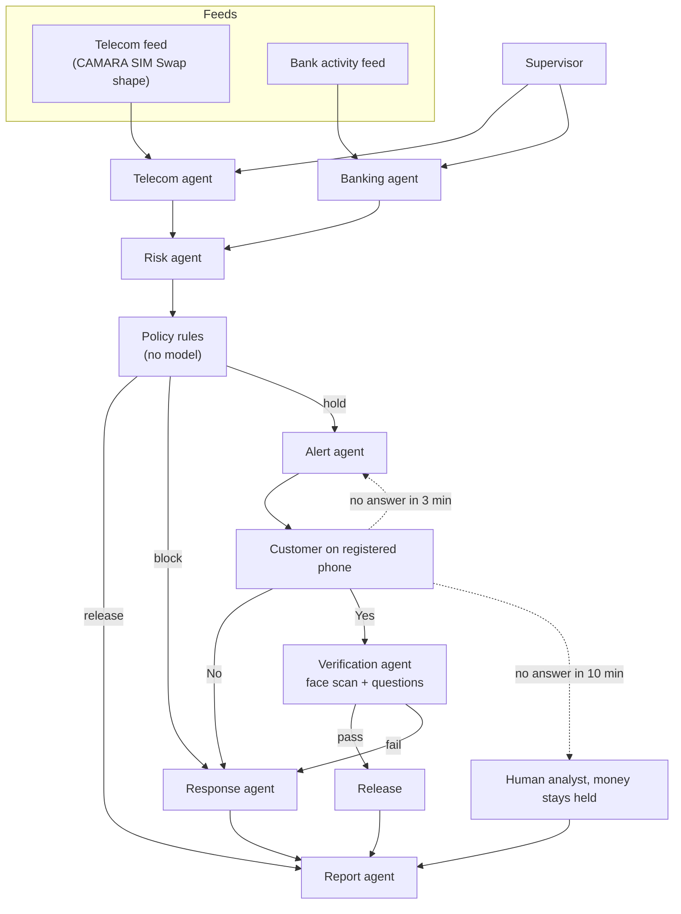

**Why several agents, not one.** The agents that read text typed by whoever sends a payment (Banking, Alert, Report)
can reach **0** money-moving tools. A single agent holding every tool could reach **5**. Splitting the work limits what a
manipulated agent could do. Accuracy is the same as a single agent using the same rules (192 of 192 decisions are
identical); the extra cost is time, about 250 ms per case, because every handoff is signed and recorded.

**Technology stack**

| Layer | Technology |
|---|---|
| Orchestration | LangGraph supervisor graph with explicit routing; the case pauses with `interrupt()` while the customer answers and resumes from a Postgres checkpoint |
| Backend | FastAPI, SQLAlchemy, Alembic, Argon2id, TOTP, HMAC-signed handoffs |
| Face verification | dlib face embeddings with a signed one-use scan challenge |
| Models | Meta (`muse-ember-1.0`), then Grok (`grok-4.20-0309-non-reasoning`), then a deterministic writer |
| Frontend | Next.js 15, React 18, TypeScript; a same-origin proxy so browser sessions use HttpOnly cookies |
| Data | PostgreSQL 16, Redis 7 (SQLite and in-memory for local tests) |
| Delivery | Docker Compose; optional Caddy front door and Cloudflare tunnel for sharing |

### The wiring process

1. The customer's payment (or a drill) creates a case. The **Supervisor** opens it and hands it to the Telecom and Banking agents.
2. Every handoff between agents is **sealed with an HMAC signature, a fresh nonce and an allowed-route check**. A forged, altered, replayed, misaddressed or stale handoff is rejected (120 of 120 hostile handoffs rejected in the benchmark).
3. Telecom and Banking read their tools in parallel, may look further (at most three extra lookups), and each writes two sentences through the model router. The router tries Meta, then Grok, then the deterministic writer.
4. Everything sent to a model is first **masked**: raw phone numbers, NIC, email and account numbers never reach it (0 leaks in 780 texts).
5. **Risk** scores the signals. **Policy** applies the rule table and, for a hold, places the hold on the ledger.
6. **Alert** notifies the customer. The graph stops at `interrupt()`; the case waits in Postgres.
7. The customer's answer resumes the case. **Verification** runs the face scan and questions. Before any release, the signals are **re-checked** (the last look before release).
8. **Response** or a release finishes the case. **Report** checks each note against its facts, files the PDF and sends the receipt.
9. Every step is written to a hash-chained audit log and to the live stream the console shows.

## What each agent may and may not do

Each agent has a written charter in code (`backend/app/charters.py`). A call to a tool outside the charter raises an error and is counted.

| Agent | Job | May call | May **not** call | Autonomy |
|---|---|---|---|---|
| **Supervisor** | Open the case, assign the two feeds | create case | block, lock, report, release | Routes only. A crash goes to the safe path and the transfer stays held |
| **Telecom** | Read SIM swap, handset, location, port-out | SIM, device, location, port-out and history reads | block, lock, release, report | Read only. At most three extra lookups per case |
| **Banking** | Read recent activity, customer profile, payee history, credential events | ledger and profile reads | block, lock, release, report | Read only. At most three extra lookups per case |
| **Risk** | Score the signals | compute score | hold, block, release, lock | Scores only. Policy decides |
| **Policy** | Release, hold or block by rule | score, hold, last-look check, release of a low-risk payment | lock account, report, SMS | No model. May hold, may release a low-risk payment |
| **Alert** | Tell the customer, no links, no codes | push, email, SMS | block, release, lock | Notifies only |
| **Verification** | Face match, then security questions | liveness, face match, questions, last-look check, release after a pass | block, lock, report | Releases only after a pass. A fake or wrong face twice goes to Response. An unsure face goes to a person |
| **Response** | Block, SIM freeze, account lock | block, SIM freeze request, lock | release, report | The only agent that may block. Fails closed |
| **Analytics** | Count payments by district, province, day; propose a threshold change | aggregate, brief, propose | hold, block, release, lock, report, any message | Proposals change nothing until an analyst approves |
| **Report** | Check notes, file the report, send the receipt | review notes, report, deliver report | block, release, lock | A note that fails the check is replaced by the rules text |

## Policies and limitations

### Decision policy

| Rule | Result |
|---|---|
| Open port-out, **and** password reset within 6 hours, **and** new payee, **and** transfer of at least Rs. 500,000 | **Block** at once, without waiting for the customer |
| Risk score at or above the hold threshold (default **45**, adjustable only between 35 and 70 with an analyst's approval) | **Hold** until the customer answers |
| SIM swap within 72 hours, **and** at least Rs. 50,000, **and** any of: new payee, port-out, new-device sign-in, password reset within 12 hours | **Hold**, whatever the score |
| Otherwise | **Release** |
| Customer says "No, this was not me" | Response blocks, requests a SIM freeze and limits the account |
| Face fails twice, or a fourth question round fails | Response blocks |
| Face unsure, no answer in 10 minutes, or the check could not settle it | A human analyst decides; the money stays held |
| Any agent crashes or a model is down | The rules still decide; the transfer stays held rather than released |

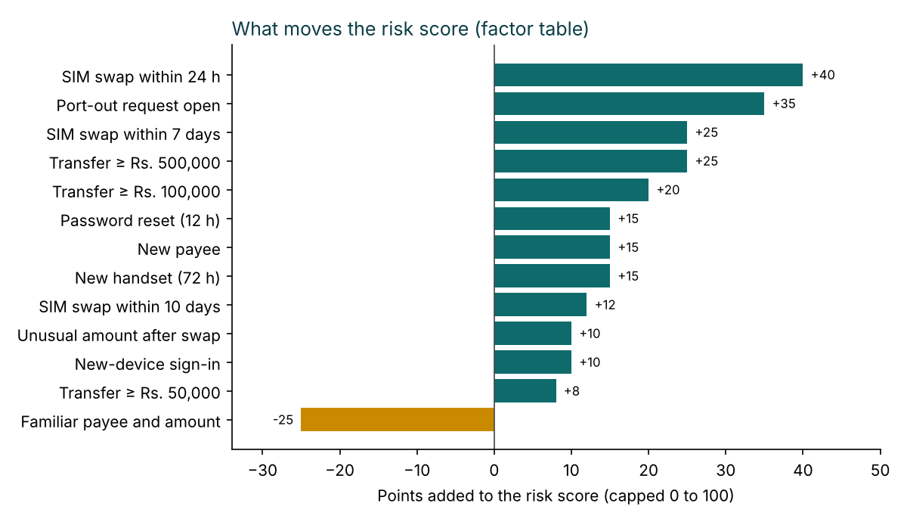

### Limitations (what this does not claim)

- **Synthetic data.** All results come from invented customers and simulated feeds. They say how the design behaves, not what real fraud rates would be.
- **Simulated operator.** The telecom feed has the CAMARA SIM Swap shape; connecting a real operator means changing `TELCO_BASE_URL` and agreeing terms with that operator. A SIM freeze is recorded as a request; no operator integration sends it.
- **False holds.** In the benchmark 26.2% of legitimate payments are held and then released after the customer's check. That is a cost in customer friction. The missed-fraud rate on payments designed to slip under the thresholds (the "red team" group) is 6.9%.
- **Face matching** is a demonstration-grade engine; lighting, camera and the person's pose affect it. It does not replace the questions.
- **Delivery receipts.** No provider callback is integrated, so the system never claims a message was "delivered".
- **Sessions.** Browser sessions use HttpOnly cookies and need the site and API on one address (the proxy provides this). A password change does not end other sessions; "sign out" ends the current one.
- **One shared database** in the demo. Use "Reset demo state" between audiences.
- **Not a certified product.** No penetration test by a third party, no regulator approval, and no production load beyond the local tests.

## Security controls

| Control | How it works |
|---|---|
| **Sign-in** | Username, Argon2id password hash, then a 6-digit authenticator code. A used code cannot be replayed. Lockouts and per-username and per-address limits (aware of trusted proxies) |
| **Sessions** | HttpOnly, SameSite=Strict cookies that page scripts cannot read; `Secure` in production. **Sign-out revokes tokens** so an earlier copy stops working at once |
| **Encryption at rest** | Authenticator secrets and face data with AES-256-GCM. Email, phone, NIC and account number with AES-256-GCM-SIV, so lookups still work. Keys derived from one `ENCRYPTION_KEY` (at least 32 characters); a wrong key stops the service at start. A key-rotation tool is included |
| **Agent handoffs** | HMAC-SHA256 signature, fresh nonce, allowed-route table, expiry |
| **Least privilege** | Each agent has a charter; out-of-charter tool calls are refused (0 occurred in 2,816 benchmark tool calls) |
| **Privacy before models** | Phone, NIC, email and account numbers are masked before any model sees the text; models never see answers or images |
| **Face scan** | A signed, short-lived, one-use challenge. The head turns are measured from the frames, so a replayed recording or still photo fails. Upload and size limits apply |
| **Messages** | SMS and email carry no link and no code; one with either is refused. Demo mode sends only to allow-listed numbers and addresses. A per-hour send budget applies |
| **Web hardening** | Explicit CORS origins, request-size limits, security headers, live-stream origin check, no endpoint returned a 500 for malformed input in testing |
| **Audit** | Hash-chained audit log; security questions are stored as hashes and the reply never says which answer was wrong |
| **Supply chain** | `bandit`, `ruff`, `pip-audit` and `npm audit` clean on the last run; Next.js upgraded to clear audit findings; CI on every push |

See also [`docs/THREAT_MODEL.md`](university-project/docs/THREAT_MODEL.md) and [`docs/RUNBOOK.md`](university-project/docs/RUNBOOK.md).

## Benchmark results

Generated by `python -m evaluation.run` (seed 7, **192 synthetic cases**, mock model). Details and caveats:
[`docs/evaluation/results.md`](university-project/docs/evaluation/results.md).

| Whole system | Accuracy | Precision | Recall | False-hold rate | Missed-fraud rate |
|---|---|---|---|---|---|
| 192 cases | **85.9%** | 82.4% | **95.4%** | 26.2% | 4.6% |

| Check | Result |
|---|---|
| Attack patterns the rules were written for (36 cases) | **0.0%** missed |
| Red-team cases shaped to slip under thresholds (72 cases) | 6.9% missed |
| Customer profile on versus off | Accuracy 65.6% → **85.9%**, missed fraud 33.3% → **4.6%** |
| Forged, altered, replayed, misaddressed and stale handoffs | **120 of 120** rejected |
| Texts given to models with a raw identifier left in | **0** of 780 |
| Agent tool calls outside the agent's charter | **0** of 2,816 |
| Cases that ended with no decision | **0** |
| Time to a decision (multi-agent graph) | p50 **246 ms**, p95 **453 ms** |
| Risk score against an independent calculation | **500 of 500** |
| Same decision with both AI models down | **15 of 15** |

<table>
<tr>
<td width="50%" valign="top">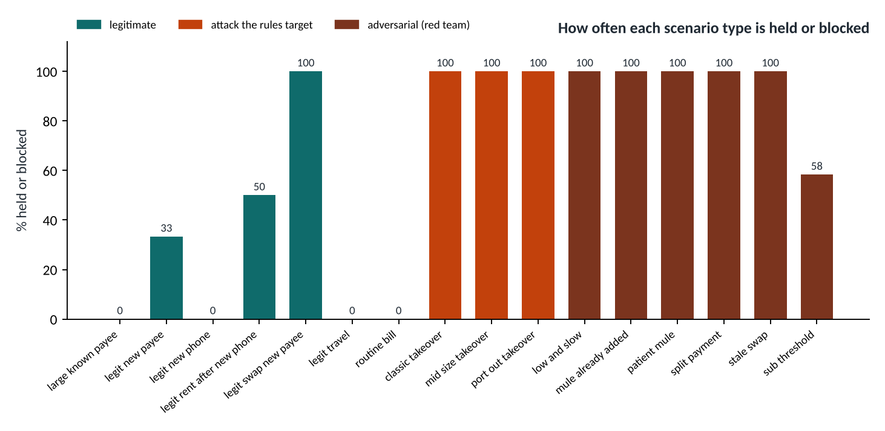<br><sub>How often each scenario type is held or blocked.</sub></td>
<td width="50%" valign="top">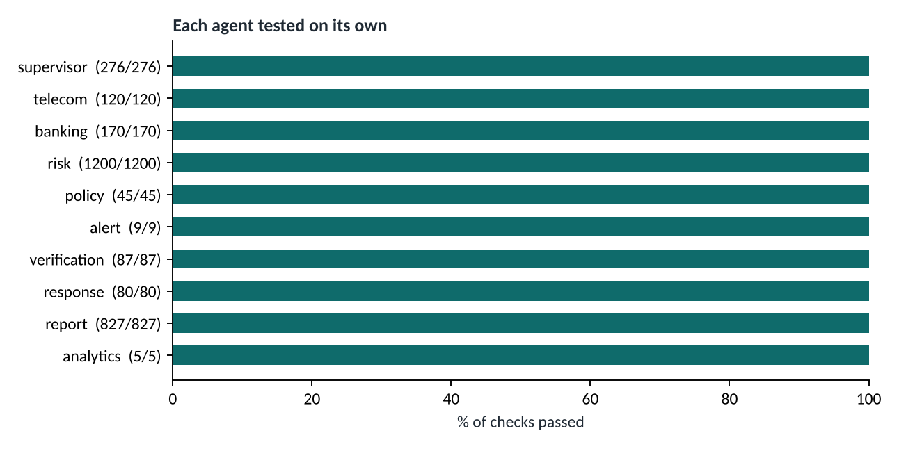<br><sub>Checks on each agent on its own.</sub></td>
</tr>
<tr>
<td width="50%" valign="top">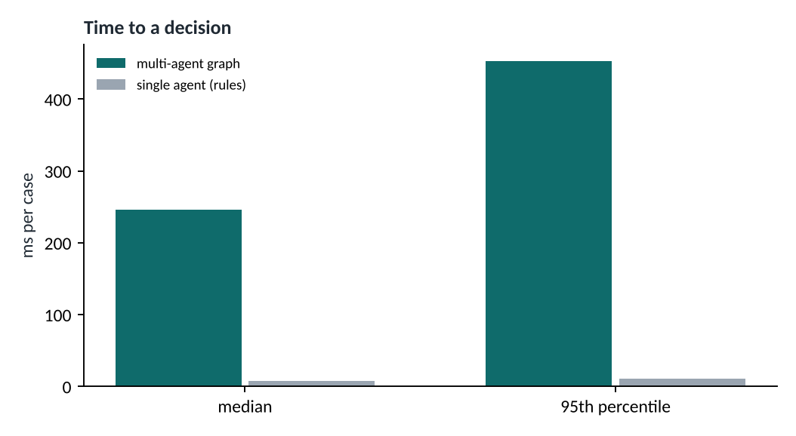<br><sub>Time to a decision.</sub></td>
<td width="50%" valign="top">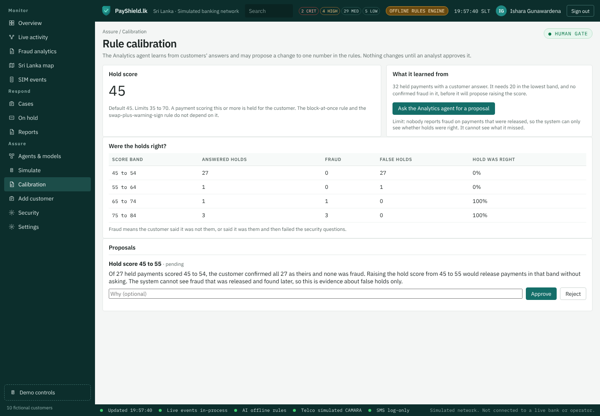<br><sub>Calibration of the hold threshold.</sub></td>
</tr>
</table>

Face matching has its own evaluation: [`docs/evaluation/face-eval.md`](university-project/docs/evaluation/face-eval.md).

## QA test results

Measured on the final code, one suite at a time, and recorded in
[`docs/TEST_REPORT.md`](university-project/docs/TEST_REPORT.md) (the plan is in
[`docs/TEST_PLAN.md`](university-project/docs/TEST_PLAN.md)). The counts below are from the last full measurement;
a later change added a handful of tests, and the suites were re-run in part.

| Check | Result |
|---|---|
| Backend suite on SQLite | **1,791 passed, 4 skipped, 0 failed** (the skips need real face photos) |
| Backend suite on Postgres 16 and Redis 7 | 1,787 passed, 6 skipped; two migration tests were corrected afterwards and re-run |
| Line and branch coverage | **93.5%** lines, **88.6%** branches |
| Browser tests (Playwright; desktop, tablet, phone) | **75 of 75** passed |
| Frontend logic tests | **31 of 31** passed |
| Mutation spot-check | **58 of 58** deliberately broken rules were caught |
| Scenario matrix | **12** scenario paths, 0 not as expected |
| API permission matrix | All **68** operations have a policy and are checked |
| Accessibility (automated axe checks) | No serious or critical violation on customer pages and all console pages |
| Static and dependency scans | `ruff` clean, `bandit` no medium or high findings, `pip-audit` and `npm audit` found nothing |
| Performance | Median decision about 0.3 s; 50 concurrent cases in 0.7 s |

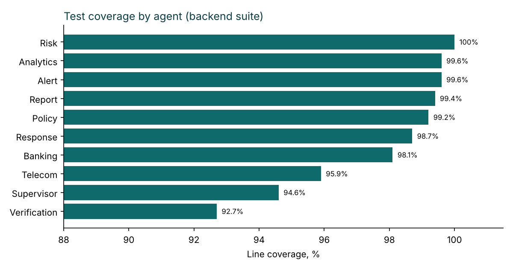

**What this cannot prove:** the tests use synthetic data, a mock model and a simulated operator. Live checks of real
providers and real cameras are done by hand, not by the suite.

## Business value

| For | Value |
|---|---|
| **Banks** | Stop a SIM-swap takeover before the money leaves, with a clear record for every decision. The rule layer is predictable and explainable to an auditor, and a hold costs the customer a minute, not their savings |
| **Customers** | The question goes to the phone and account they registered, not to the SIM a fraudster controls. No code is ever texted, so there is nothing to read out to a caller |
| **Fraud analysts** | One screen with both feeds, each agent's evidence and a ready PDF report, instead of switching between telecom and bank systems |
| **Operators (telecom)** | A standard SIM-swap signal (CAMARA shape) that many banks can use, so the operator offers one integration instead of many |
| **Regulators and auditors** | Hash-chained audit trail, signed handoffs, written agent charters, and every release re-checked before money moves |

**Where the value comes from, in this design:**
- **Fewer takeover losses**: the hold happens before the transfer completes, on the SIM change plus the payment pattern together.
- **Less analyst time per case**: evidence is gathered and a report is drafted automatically, and a person only decides what the rules cannot settle.
- **Controlled cost of friction**: the customer profile cut missed fraud in our benchmark from 33.3% to 4.6% and raised accuracy from 65.6% to 85.9%, at a 26.2% false-hold rate that the threshold calibration page lets an analyst tune.
- **Low model cost and no model risk to the money**: models write notes only, so a model outage or a manipulated note cannot release a payment.

> These are properties of the design and the benchmark. They are not a forecast of savings; real savings depend on a bank's
> real fraud rate, volumes and thresholds, which would be measured in a supervised pilot.

## Impact

**Social impact**
- Protects ordinary account holders, including people who rely on mobile banking, from losing savings in a few minutes after a SIM swap.
- Keeps the customer in control: the answer is theirs, and a human analyst reviews anything the rules cannot settle.
- Uses face data with care: stored encrypted, never shown back, and never sent to a model.

**Technology improvement**
- Pairs two data worlds, telecom and banking, that are usually separate, using an open API shape (CAMARA SIM Swap).
- Shows a **safe pattern for agentic AI in finance**: many narrow agents with written charters, signed handoffs, a deterministic decision layer, and models restricted to explanation.
- A fallback chain (Meta, then Grok, then rules) means the service degrades but never stops deciding.

**National market (Sri Lanka)**
- Fits the way Sri Lankans bank: mobile numbers tied to accounts, SMS alerts, and several banks and operators that would each need the same integration.
- A shared pattern could let banks and operators in the country agree on one SIM-swap signal and one customer-confirmation flow, instead of building separate ones.
- The pilot is built around local rules and context (rupee thresholds, districts and provinces, and CBSL and TRCSL context in reports, marked as demonstration notes).

**Global market**
- SIM-swap fraud is not specific to one country. The same flow applies wherever banks rely on a phone number, and the CAMARA API shape is designed to work across operators.
- The agent charters, decision policy and test approach carry over; what changes per market are the thresholds, languages, regulation and operator integration.
- Moving from the pilot to a production service would need real operator and bank integrations, an independent security review and regulator engagement, which this project does not claim to have done.

## AI assistance

AI coding assistance was used in shaping the code and the project frame (the structure and layout of the repository).

## Run it

```bash
git clone https://github.com/AKMaasif/paysheildlk-university.git
cd paysheildlk-university/university-project
cp .env.example .env        # set JWT_SECRET, HMAC_KEY and ENCRYPTION_KEY (32+ characters) before real use
docker compose up --build   # console and customer site at http://localhost:3000
```

- Console: http://localhost:3000 · Customer site: http://localhost:3000/c · API docs: http://localhost:8000/docs · Health: http://localhost:8000/api/health
- **Demo controls** shows each demo customer's registration details, security answers and authenticator QR code.
- Step-by-step guide for a Windows PC with Docker Desktop: [`docs/LOCAL_TESTING.md`](university-project/docs/LOCAL_TESTING.md).
- Sharing the customer view on a phone through a tunnel: [`docs/SHARE_ONLINE.md`](university-project/docs/SHARE_ONLINE.md).

**SMS and email.** The drivers are `TEXTLK_API_KEY` (Text.lk) and `SMTP_*`. In demo mode, real messages go only to
numbers and addresses listed in `DEMO_ALLOWED_PHONES` and `DEMO_ALLOWED_EMAILS`.

**Run the checks, one at a time** (running them together makes timing-sensitive tests flaky):

```bash
cd backend && python -m pytest -q
cd backend && python -m qa.scenario_matrix
cd backend && python -m evaluation.run
cd frontend && npx tsc --noEmit && npm test
cd e2e && npm test
```

## Version information

| Item | Version |
|---|---|
| PayShield.lk | **0.1.0** (pilot) |
| Python (Docker image) | 3.12 |
| FastAPI / Uvicorn | 0.163.1 / 0.54.0 |
| LangGraph | 1.2.22 (Postgres checkpointer 3.2.1, SQLite 3.1.3) |
| Alembic (database migrations) | 1.20.1 · migrations 0001 to 0005 |
| Face engine | dlib-bin 20.0.1 with face_recognition_models 0.3.0 |
| Node (Docker image) / Next.js / React / TypeScript | 22 / 15.5.29 / 18.3.1 / 5.7.2 |
| PostgreSQL / Redis / Caddy | 16 / 7 / 2.8 |
| Models | Meta `muse-ember-1.0` (main) · Grok `grok-4.20-0309-non-reasoning` (fallback) · deterministic writer |

## Documentation

| Document | What it covers |
|---|---|
| [`docs/LOCAL_TESTING.md`](university-project/docs/LOCAL_TESTING.md) | Run and test on your own PC |
| [`docs/SHARE_ONLINE.md`](university-project/docs/SHARE_ONLINE.md) | Share the customer view through a tunnel |
| [`docs/DEMO_GUIDE.md`](university-project/docs/DEMO_GUIDE.md) | Demo script and what to set |
| [`docs/ARCHITECTURE_MAP.md`](university-project/docs/ARCHITECTURE_MAP.md) | Architecture map |
| [`docs/THREAT_MODEL.md`](university-project/docs/THREAT_MODEL.md) | Threat model |
| [`docs/DEPLOYMENT.md`](university-project/docs/DEPLOYMENT.md) · [`docs/RUNBOOK.md`](university-project/docs/RUNBOOK.md) | Deployment and operations |
| [`docs/TEST_PLAN.md`](university-project/docs/TEST_PLAN.md) · [`docs/TEST_REPORT.md`](university-project/docs/TEST_REPORT.md) | Test plan and results |
| [`docs/SCENARIO_MATRIX.md`](university-project/docs/SCENARIO_MATRIX.md) | The twelve scenario paths |
| [`docs/STATUS.md`](university-project/docs/STATUS.md) | What is done and what is open |
| [`university-project/README.md`](university-project/README.md) | The technical README |

## Folders

```
.github/workflows/      CI: backend, frontend, browser and security scans
university-project/
  backend/              FastAPI app, agents, graph, tests, evaluation and QA tools
  frontend/             Next.js fraud desk console and the mobile customer site
  e2e/                  Playwright browser tests
  deploy/               Caddy front door used for sharing
  docs/                 Guides, test reports, evaluation results, screenshots
  docker-compose.yml    Postgres, Redis, backend, frontend, optional share front door
```

---

<sub>PayShield.lk is an independent pilot built for study. BankCylone is a fictional bank. No real customer data is used.</sub>
