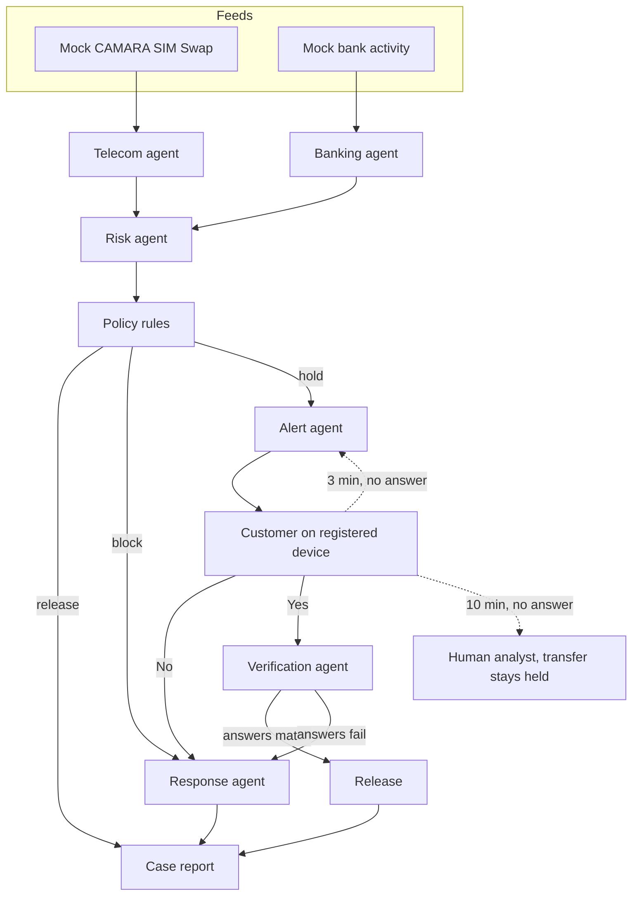

# PayShield

Pilot desk for SIM-swap fraud on Sri Lankan bank payments. A telecom feed and a bank feed are read in parallel. A fixed rule layer holds, blocks, or releases the money. The customer answers on the phone they registered, not by SMS. The language model writes the analyst note. It does not choose the disposition.

People, numbers, and balances in the seed data are fictional.

## What runs



The supervisor graph is LangGraph. Routing is explicit. While the customer is answering, the graph is paused with `interrupt()` and a Postgres checkpointer (SQLite if Postgres is not the app database). Resume continues the same case.

After a customer says the payment was theirs, the desk asks for a live camera selfie and then up to four rounds of three knowledge questions. A second fake selfie, or a fourth failed round, blocks the payment. Answers are salted hashes. The authenticator secret is encrypted with AES-256-GCM (`ENCRYPTION_KEY`). Agent handoffs can be checked with `HMAC_KEY`. `TEXTLK_API_KEY` and `SMTP_*` turn on the real SMS and email drivers; empty values stay on the log driver.

| Piece | Role |
| --- | --- |
| `POST /sim-swap/v1/check` and `/retrieve-date` | Same request and response shape as the GSMA CAMARA SIM Swap API. Swap `TELCO_BASE_URL` later for a real operator. |
| Telecom and banking agents | Call tools, then ask the model for two sentences. |
| Policy | `decide_policy` in `backend/app/risk.py`. No model call. |
| Alert | Web push when Firebase is configured, plus email, plus a generic SMS with no link and no code. The customer app also updates over WebSocket, which is what the demo uses. |
| Customer app | Email, password, authenticator TOTP. No SMS one-time code. |
| Case report | Markdown and PDF for a fraud desk, with CBSL and TRCSL context marked as a demonstration note. |

## Run it

```bash
cp .env.example .env
docker compose up --build
```

Open the operator console at http://localhost:3000 and the customer app at http://localhost:3000/c.

API docs: http://localhost:8000/docs.

With no keys set, every model call uses the deterministic mock. Gemini is primary when `GEMINI_API_KEY` is set (`gemini-2.5-flash` by default). On rate limit, timeout, or other errors it falls back to the Meta Model API (`META_API_KEY`, base `https://api.meta.ai/v1`, model `muse-ember-1.0`). Each call records which provider answered. If both fail, the mock still answers so the desk does not stop.

Leave `TEXTLK_API_KEY`, `SMTP_*`, and `FIREBASE_*` empty to log SMS and email and to keep push on the in-app channel.

Postgres is the app database and the LangGraph checkpointer inside Compose. If the Postgres checkpointer cannot start, the process falls back to a SQLite checkpointer file. Redis Streams and Pub/Sub carry live events; if Redis is down, the process fans events out in memory. The WebSocket is the UI stream either way.

### Without Docker

```bash
cd backend
python -m venv .venv && . .venv/bin/activate
pip install -r requirements.txt
uvicorn app.main:app --reload --port 8000
```

```bash
cd frontend
npm install
npm run dev
```

That backend uses SQLite under `backend/data/` and the in-memory event bus.

Tests:

```bash
cd backend
pytest
```

They cover the customer No path, the Yes path, a failed verification, the 3-minute re-alert and 10-minute escalation, a routine release, an immediate block, the CAMARA mock, and the Gemini to Meta to mock fallback.

## Demo script

Sign in on the console as `analyst@payshield.lk` / `pilot-analyst`.

1. Open **Demo control**. Leave the customer on Nimal Perera and the scenario on **SIM swap and Rs. 200,000 to a new payee**. Trigger the case.
2. Open **Live Agent Activity**. Telecom and banking run together, risk scores, the rule layer holds the transfer, and the alert lane waits. Click a step. The details pane shows the tool arguments and the result.
3. On a phone, or another window, open http://localhost:3000/c. Sign in as `nimal.perera@mail.lk` / `pilot-nimal`. The authenticator code and the QR are on Demo control. They refresh every 30 seconds.
4. The question is **Did you make this payment of Rs. 200,000 to K.D. Enterprises?**
5. **No** blocks the transfer, asks the mock operator for a SIM freeze, limits the account, and files a report. **Yes** asks for the first school (`Royal College`) and the city of birth (`Galle`) before release. A wrong answer blocks.
6. Download the report from the case file or from **Reports** (markdown or PDF).
7. To show the other rules without waiting: **Port-out, password reset, and Rs. 800,000** blocks immediately. **Routine bill of Rs. 4,850** on Dilani Wijesinghe releases without asking.
8. **Run the 3-minute re-alert now** and **Run the 10-minute escalation now** call the same handlers the timer uses. Left alone, the realert is at 3 minutes and escalation at 10, and the transfer stays held.
9. **Reset demo state** deletes only rows created from Demo control.

A bank supervisor (`supervisor@payshield.lk` / `pilot-supervisor`) is scoped to Commercial Bank and can release or block a held payment from **Transactions on Hold**. The auditor is read-only. The super admin (`admin@payshield.lk` / `pilot-admin`) sees Administration.

| Console | Password | Scope |
| --- | --- | --- |
| analyst@payshield.lk | pilot-analyst | All banks |
| telco@payshield.lk | pilot-telco | SIM feed and cases |
| supervisor@payshield.lk | pilot-supervisor | Commercial Bank only |
| auditor@payshield.lk | pilot-auditor | Read-only |
| admin@payshield.lk | pilot-admin | Administration |

Customer passwords are `pilot-` plus the first name (`pilot-nimal`, `pilot-dilani`, …). Demo assist must be off (`DEMO_ASSIST=false`) before any real person uses the workspace. Change `JWT_SECRET` before sharing the host.

## Timeouts and customer contact

No answer for 3 minutes sends the push, the email, and the same generic SMS again. No answer for 10 minutes resumes the graph as a timeout, assigns the case to a person, and leaves the money held. Saying yes starts a fresh 10-minute window for the security answers.

SMS text never contains a URL or a 4 to 8 digit code. The check lives in `backend/app/notify.py` and runs for every driver, including Text.lk.

Push is device-bound. The customer app registers the browser after TOTP. Firebase is used when `FIREBASE_PROJECT_ID`, `FIREBASE_CLIENT_EMAIL`, and `FIREBASE_PRIVATE_KEY` are set. Otherwise the open page updates over WebSocket, including on an iPhone that has not installed the Home Screen app.

## Layout

```
backend/app/agents/graph.py    supervisor graph
backend/app/risk.py            score and the hold / block / release rules
backend/app/facts.py           CAMARA-shaped SIM swap reads
backend/app/llm.py             Gemini, Meta, mock
frontend/app/(console)         operator desk
frontend/app/c                 customer app
```

The operator desk is a desktop layout: menu, a short ribbon, the case pages, and a details pane that opens on the selected row. The customer app is a narrow layout meant for a phone. A bank supervisor only sees their own bank; that limit is enforced on the server.
