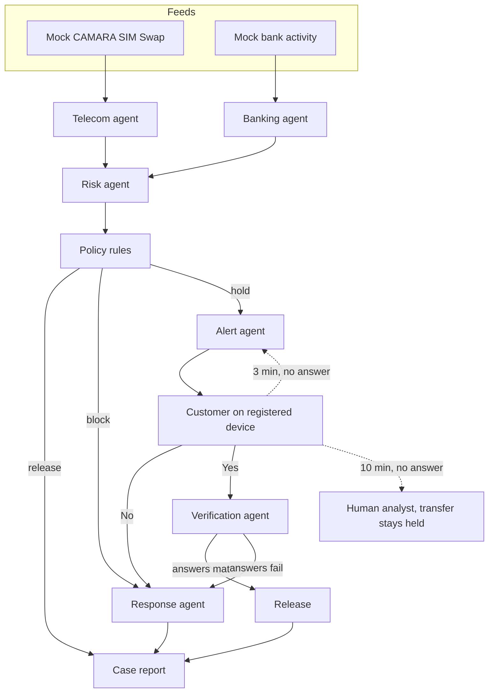

<p align="center"></p>

# PayShield

Pilot desk for SIM-swap fraud on Sri Lankan bank payments. A telecom feed and a bank feed are read in parallel. A fixed rule layer holds, blocks, or releases the money. The customer answers on the phone they registered, not by SMS. The language model writes the analyst note. It does not choose the disposition.

People, numbers, and balances in the seed data are fictional. All of them bank with one fictional bank, BankCylone.

## What runs



The supervisor graph is LangGraph. Routing is explicit. While the customer is answering, the graph is paused with `interrupt()` and a Postgres checkpointer (SQLite if Postgres is not the app database). Resume continues the same case.

After a customer says the payment was theirs, the desk asks for a live camera selfie and then up to four rounds of three knowledge questions. A second fake selfie, or a fourth failed round, blocks the payment. Answers are salted hashes. The authenticator secret is encrypted with AES-256-GCM (`ENCRYPTION_KEY`). Agent handoffs can be checked with `HMAC_KEY`. `TEXTLK_API_KEY` and `SMTP_*` turn on the real SMS and email drivers; empty values stay on the log driver.

| Piece | Role |
| --- | --- |
| `POST /sim-swap/v1/check` and `/retrieve-date` | Same request and response shape as the GSMA CAMARA SIM Swap API. Swap `TELCO_BASE_URL` later for a real operator. |
| Telecom and banking agents | Run their core read tools, look further when what they read calls for it (capped at three extra lookups), then ask the model for two sentences. Banking also compares the payment with what is usual for the customer. |
| Policy | `decide_policy` in `backend/app/risk.py`. No model call. |
| Alert | Web push when Firebase is configured, plus email, plus a generic SMS with no link and no code. The customer app also updates over WebSocket, which is what the demo uses. |
| Customer site | Landing page, first-time registration (name, email, NIC, mobile, account number, live face scan, password), then username and password. Account summary, transactions, and a forced password change after any alert. No SMS one-time code. |
| Case report | Checks each agent note against the facts it was written from, then files Markdown and PDF for a fraud desk, with CBSL and TRCSL context marked as a demonstration note. |

## Run it

```bash
cp .env.example .env
docker compose up --build
```

Open the operator console at http://localhost:3000 and the customer site at http://localhost:3000/c.

API docs: http://localhost:8000/docs.

With no keys set, every model call uses the deterministic mock. Gemini is primary when `GEMINI_API_KEY` is set (`gemini-2.5-flash` by default). On rate limit, timeout, or other errors it falls back to the Meta Model API (`META_API_KEY`, base `https://api.meta.ai/v1`, model `muse-ember-1.0`). Each call records which provider answered. If both fail, the mock still answers so the desk does not stop.

Leave `TEXTLK_API_KEY`, `SMTP_*`, and `FIREBASE_*` empty to log SMS and email and to keep push on the in-app channel.

Postgres is the app database and the LangGraph checkpointer inside Compose. If the Postgres checkpointer cannot start, the process falls back to a SQLite checkpointer file. Redis Streams and Pub/Sub carry live events; if Redis is down, the process fans events out in memory. The WebSocket is the UI stream either way.

### Course folder layout

The whole project lives in the `university-project/` folder of the repository. Run every command below from inside it.

```
university-project/
├── project/
│   ├── main.py              starts the API (python project/main.py)
│   └── requirements.txt     Python dependencies (points at backend/requirements.txt)
├── README.md
├── docs/
│   ├── Proposal.docx        problem, solution and planned implementation
│   ├── Workflow.md          process flow and implementation steps
│   └── PROJECT_DETAILS.md   objectives, features, functionality, technical details
├── backend/                 agents, rules, API, tests
├── frontend/                operator console and customer app
└── docker-compose.yml
```

The application code stays in `backend/` and `frontend/`, so Docker Compose and the tests work as before. Quick start without Docker:

```bash
pip install -r project/requirements.txt
python project/main.py        # API on http://localhost:8000
cd frontend && npm install && npm run dev
```

### Without Docker

```bash
cd backend
python -m venv .venv && . .venv/bin/activate
pip install -r requirements.txt
uvicorn app.main:app --reload --port 8000
```

```bash
cd frontend
npm install
npm run dev
```

That backend uses SQLite under `backend/data/` and the in-memory event bus.

Tests:

```bash
cd backend && pytest                 # 1,558 backend cases: agents, rules, API permissions, security, load, resilience
cd e2e && npm install && node run.mjs   # 73 browser tests, desktop and phone, with accessibility checks
cd frontend && npm test              # 20 tests for the API client and formatting
cd backend && python -m qa.mutation_check   # breaks 38 rules on purpose and checks the tests notice
cd backend && TEST_DATABASE_URL=postgresql+psycopg://user@host:5432/db TEST_REDIS_URL=redis://host:6379/0 pytest   # the same tests on a real Postgres and Redis (the database is emptied between tests: use a throwaway one)
```

`.github/workflows/ci.yml` (at the repository root) runs all of this on every push: backend lint and tests with an 85% coverage floor, the static scan and dependency audits, the frontend tests and build, and the browser suite. It also runs weekly, with the mutation check, because new advisories appear without any code change.

`docs/TEST_PLAN.md` is the plan and `docs/TEST_REPORT.md` the result: counts, coverage, defects found, and what the tests cannot prove.

## Database changes

The database schema is versioned with Alembic scripts in `backend/app/migrate/versions/`. At startup the service builds an empty
database from the models, brings a database from before migrations up to date and marks it, or runs the scripts a database is behind on.
After you change a model, write the script with:

```bash
cd backend
python -m app.migrate new "what changed"
```

It writes nothing when the models and scripts already agree. Read the script it writes before committing it. A test fails if a model
changes without a script, and another upgrades an older database and checks its data survives. The scripts are checked against the
models on SQLite and on Postgres.

## Face verification

At registration the customer's face is scanned live and kept, encrypted (AES-256-GCM), as up to three images and up to five face templates. When the customer answers "Yes, it was me" to an abnormal payment, they scan their face again and the new scan is compared with the stored one. Only a successful match lets them go on to the security questions, and the questions still decide the release.

| Step | What it does |
| --- | --- |
| Matching | dlib face model (128-number embeddings, 99.38% on the LFW benchmark). The result is a **similarity score from 0 to 100**, not a yes or no |
| Tiers | **match** (80 or more): go on to the questions. **likely** (60 to 79): go on, but only two question rounds. **unsure** (30 to 59): one more scan, then a person at the bank reviews it and the money stays held. **no match** (under 30): a strike, and the second strike blocks the payment |
| Image quality | Checks for one face, size, sharpness, brightness, contrast, head angle and open eyes. A poor picture gets guidance (move closer, face a light, remove sunglasses) and three free retakes. It never counts as a strike |
| Liveness | The server issues a random, signed, single-use challenge (two of: turn left, turn right, open your mouth). A short burst of frames must show the same face following it. This stops a printed photo, a still image and a replayed video. It does **not** stop a live deepfake or a 3D mask |
| Changing looks | Several enrolment templates, a graded score, an extra try for unsure results, and refreshing the templates only after a very confident match that also passed the security questions |
| Fallbacks | Unsure, poor-quality three times, no face on file, or the face engine unavailable all go to a person. Nothing is ever released automatically on a doubtful face |

**Honest limits.** The thresholds are conservative starting points taken from the model's published operating point, not measurements on your customers. Run `python -m evaluation.face_eval --images DIR` on a folder of your own labelled photos (a few hundred people) to measure false accepts and false rejects before relying on them. `docs/evaluation/face-eval.md` is a run on only four people, so its error rates mean almost nothing. A drawn cap or beard is not a real one. There is no learned presentation-attack model.

Set `FACE_ENGINE=legacy` to use the old two-frame demo check (no recognition), and `FACE_CHALLENGE=false` for demos that feed a still photo to the camera. Both weaken the check and are for demonstrations only. The models come from `dlib-bin` and `face_recognition_models` (about 100 MB).

## Agentic features, and what each one really is

| Feature | What it does | Honest caveat |
| --- | --- | --- |
| Evaluation harness | `python -m evaluation.run` runs every agent alone, the whole graph on synthetic scenarios, a single-agent baseline, a red-team set, and prompt-injection runs. Results: `docs/evaluation/results.md` | Synthetic data. See `docs/evaluation/NOTES.md` for what the numbers do not say |
| Investigator behaviour | Telecom and Banking choose extra read-only lookups after their first reads. A model plans when a key is set; a small rule planner does otherwise and says so | Extra lookups feed the notes. They cannot change the decision |
| Customer profile | Usual payees and amounts from the customer's own ledger lower the score for familiar behaviour and raise it for an unusual amount after a SIM change (`CUSTOMER_PROFILE=false` turns it off) | Plain statistics, not machine learning. Never touches the block-at-once or swap-plus-warning rules |
| Critic check | The Report agent checks each note against its facts and replaces a bad one with the rules text | Pattern and set checks, not a model. It will not catch careful prose that is subtly wrong |
| Calibration with a human gate | The Analytics agent learns from customer answers and may propose a new hold score. An analyst approves or rejects on the **Calibration** page | It can see false holds, not missed fraud, so it can only ever propose raising the score, within hard limits |
| MCP | The read tools are served through the Model Context Protocol, one server per agent (`MCP_TOOLS=true` routes the graph's lookups through it; `python -m app.mcp_tools serve telecom` serves it over stdio) | A standard way in and a second charter check. It changes no outcome and costs time. Never offers a money-moving tool |
| Prompt-injection tests | Hostile payee names and notes are quoted as data, secrets are kept from models, and 38 tests check that nothing changes | With the mock model nothing can truly be talked into anything. The tests cover the code around a model |

## Security model

| Control | Where |
| --- | --- |
| Passwords | Argon2id (`argon2-cffi`). Older PBKDF2 hashes are replaced on the next successful sign-in. |
| Security answers | Per-answer salted PBKDF2-SHA256. The app never says which answer in a round was wrong. |
| Face-scan reference, personal details | AES-256-GCM with `ENCRYPTION_KEY`. |
| Sessions | 30-minute access tokens, 12-hour refresh tokens. A refresh token cannot be used as an access token. |
| Brute force | 5 failed passwords per account and 5 failed registration matches per account number and 6 wrong current passwords per customer inside the window return 429. Step-up answers and selfies are rate limited per case. |
| Step-up | The selfie verdict and the question grading are made on the server. A client cannot claim a pass, answer another customer's case, or skip a question. |
| Agent handoffs | Each step signs what it hands on with HMAC-SHA256 (`HMAC_KEY`), a nonce and a timestamp. The receiver checks the route, addressee, case, age, signature and replay before acting. Money is released only on a signed release instruction. |
| Agent limits | Each agent has a charter (`backend/app/charters.py`). A tool call outside it is refused in code. |
| Model privacy | Phone, email, account and NIC numbers are masked before any text reaches a model. Text that carries a password, answer or code is refused. |
| Audit | Every operator action is in a hash chain (SHA-256 of the previous entry). The Security page re-checks the chain. |
| Startup | With `APP_ENV=production` the backend will not start on development secrets, with `DEMO_ASSIST` on, or unless `ALLOWED_ORIGINS` lists the real `https://` address of the site. |
| Monitoring | `GET /api/ready` is a health check that fails when the database, the checkpointer or the reminder timers are down. `GET /api/ops/metrics` gives operators the numbers to alert on (held money age, unanswered customers, agent errors, failed notifications, rate-limit blocks, audit chain), as JSON or Prometheus text. Every response has an `X-Request-ID`; `LOG_FORMAT=json` writes structured logs; tokens and passwords are blanked from every log line. See `docs/RUNBOOK.md`. |
| Browser access | Only the sites in `ALLOWED_ORIGINS` may call the API from a browser (the local front end by default). Credentials and cookies are never allowed; sign-in is a bearer token. Only GET, POST and OPTIONS are accepted. |

The selfie check compares two frames from the live camera. It is a demonstration check, not bank-grade face liveness.

## Emergencies

Every row below is code that runs, not a message. The **Simulate** page has one button per scenario and each run is written to the audit log. Payment decisions never depend on a model, so none of these can release money.

| Situation | What the system does |
| --- | --- |
| Both AI models down | The rules engine writes the agent notes. The hold, block or release decision is the same, and nothing is released automatically. Notes are marked as fallback. |
| Customer does not answer | Reminder at 3 minutes, escalation to an analyst at 10. The payment stays held. |
| SMS or email failing | One retry, then the other channels. The customer is still reached by push and the app inbox. If both fail, the case is flagged for a desk analyst. Nothing is recorded as sent that was not. |
| Fraud spike in a district | Eight held or blocked payments in ten minutes, or an analyst's switch, puts the district in emergency mode. Payments of Rs. 50,000 or more there are held for the customer's confirmation even if the rules would release them. It can only turn a release into a hold. The analyst switch is stored in the database and survives a restart. |
| An agent crashes | The runner's fail-safe holds the money, hands the case to an analyst and tells the customer the payment is on hold. A payment that was already blocked or released stays that way. |
| Analyst manual switch | Freeze the account or block the payment. The use is audited with the analyst's name and reason, appears in the case timeline, tells the customer, and files the same report and receipt as an automatic block. A released payment cannot be blocked. |

## Demo script

For the full presenter pack (modes, setup, a ten-step script, what each status means, measured limits and what is still unverified) see `docs/DEMO_GUIDE.md`. The architecture is in `docs/ARCHITECTURE_MAP.md` and the expected-against-observed scenario table is `docs/SCENARIO_MATRIX.md`.

Sign in on the console as `analyst@payshield.lk` / `pilot-analyst`.

1. Open **Demo control**. Leave the customer on Nimal Perera and the scenario on **SIM swap and Rs. 200,000 to a new payee**. Trigger the case.
2. Open **Live Agent Activity**. Telecom and banking run together, risk scores, the rule layer holds the transfer, and the alert lane waits. Click a step. The details pane shows the tool arguments and the result.
3. On a phone, or another window, open http://localhost:3000/c and choose **Register**. Demo control shows the registration details for the chosen customer (name, email, NIC, mobile, account number). Type them in, take the face scan, and choose a password. Any detail that does not match the BankCylone record is refused.
4. The question is **Did you make this payment of Rs. 200,000 to K.D. Enterprises?**
5. **No** blocks the transfer, records a *simulated* SIM-freeze request (no operator is contacted), limits the account, and files a report. **Yes** asks for a live face scan first. After a match (or a likely match) the customer answers rounds of three security questions (for the demo customer: first school `Royal College`, city of birth `Galle`). A mismatching second scan, or a fourth failed round, blocks the payment. An unsure scan gets one more try and then goes to a person with the money held. Before any release the rules read the signals once more and stop the release if something worse has arrived.
6. Download the report from the case file or from **Reports** (markdown or PDF).
7. To show the other rules without waiting: **Port-out, password reset, and Rs. 800,000** blocks immediately. **Routine bill of Rs. 4,850** on Dilani Wijesinghe releases without asking.
8. **Run the 3-minute re-alert now** and **Run the 10-minute escalation now** call the same handlers the timer uses. Left alone, the realert is at 3 minutes and escalation at 10, and the transfer stays held.
9. **Reset demo state** deletes only rows created from Demo control. **Return to first-time state** puts a customer back to unregistered so the registration can be shown again.
10. After the alert is settled the customer is asked to change the password: current password, new password, re-enter. The change is stored, and an email and an SMS confirm it. From then on they log in with their username (their full name) and the password.

A bank supervisor (`supervisor@payshield.lk` / `pilot-supervisor`) is scoped to BankCylone and can release or block a held payment from **Transactions on Hold**. The auditor is read-only. The super admin (`admin@payshield.lk` / `pilot-admin`) sees Administration.

| Console | Password | Scope |
| --- | --- | --- |
| analyst@payshield.lk | pilot-analyst | All banks |
| telco@payshield.lk | pilot-telco | SIM feed and cases |
| supervisor@payshield.lk | pilot-supervisor | BankCylone only |
| auditor@payshield.lk | pilot-auditor | Read-only |
| admin@payshield.lk | pilot-admin | Administration |

Customers have no preset password. Each one chooses theirs when they register, and the console's **Add customer** page stores the bank record they register against (name, email, NIC, mobile, account number, opening balance). Demo assist must be off (`DEMO_ASSIST=false`) before any real person uses the workspace. Change `JWT_SECRET` before sharing the host.

## Timeouts and customer contact

No answer for 3 minutes sends the push, the email, and the same generic SMS again. No answer for 10 minutes resumes the graph as a timeout, assigns the case to a person, and leaves the money held. Saying yes starts a fresh 10-minute window for the security answers.

SMS text never contains a URL or a 4 to 8 digit code. The check lives in `backend/app/notify.py` and runs for every driver, including Text.lk.

Push is device-bound. The customer site registers the browser when the customer signs in. Firebase is used when `FIREBASE_PROJECT_ID`, `FIREBASE_CLIENT_EMAIL`, and `FIREBASE_PRIVATE_KEY` are set. Otherwise the open page updates over WebSocket, including on an iPhone that has not installed the Home Screen app.

## Layout

```
backend/app/agents/graph.py    supervisor graph
backend/app/risk.py            score and the hold / block / release rules
backend/app/facts.py           CAMARA-shaped SIM swap reads
backend/app/llm.py             Gemini, Meta, mock
frontend/app/(console)         operator desk
frontend/app/c                 customer site (landing, register, log in, account, password)
```

The operator desk is a desktop layout: menu, a short ribbon, the case pages, and a details pane that opens on the selected row. The customer site is responsive and works on a phone. A bank supervisor only sees their own bank; that limit is enforced on the server.
