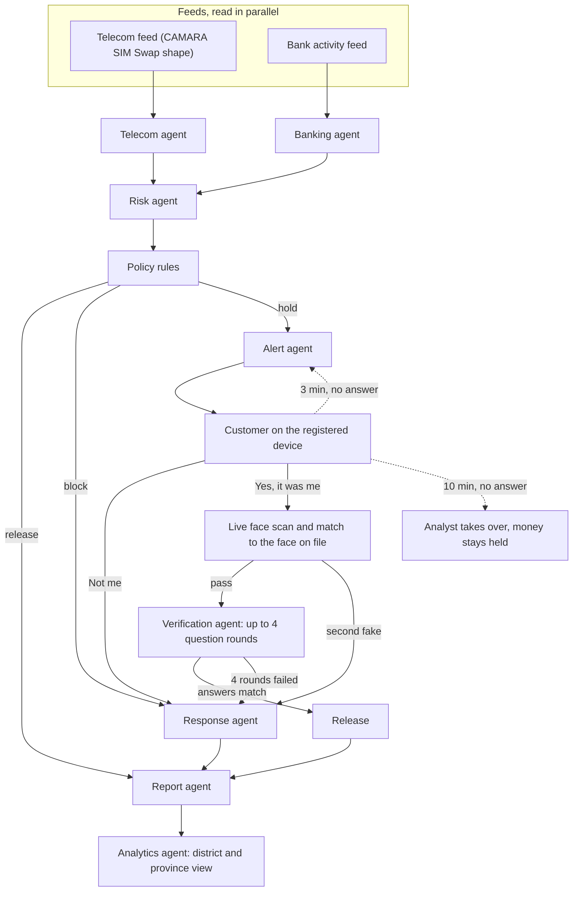

# Workflow

How a payment moves through PayShield, from the first signal to the closed case. Everything below is what the code does today.

## 1. Process flow



## 2. Implementation steps

0. **Register (once).** The bank's record for the customer (name, email, NIC, mobile number, account number) is added from the console. The customer registers on the customer site: every detail must match that record, a live face scan is taken, and they choose a password. From then on they sign in with their username (their full name) and the password.

1. **Detect.** A payment or account action arrives. The supervisor opens a case and wakes the telecom and banking agents together.
2. **Collect facts.** The telecom agent reads SIM swap, handset change, location and port-out. The banking agent reads the payee, the amount and the customer's usual pattern. Both are read-only.
3. **Score.** The risk agent combines the two into a score and a list of reasons.
4. **Decide.** `decide_policy` (`backend/app/risk.py`) is a fixed rule set. No language model is involved. The result is release, hold or block.
   - A district in emergency mode can only turn a release into a hold.
5. **Alert (hold).** The customer gets a push notification, an email and a generic SMS (no link, no code), and the customer app updates live.
6. **Customer answers.**
   - **Not me:** the payment is blocked, the account is limited, the SIM freeze is requested, and a report with a receipt is sent.
   - **Yes:** the customer scans their face again. It must be a live person following a random instruction, and the face must match the one stored at registration (a similarity score, not a yes or no). Then up to four rounds of questions (two if the match was only "likely"). One retake is allowed; a second fake blocks the payment. Then up to four rounds of three questions. The app never says which answer was wrong.
7. **No answer.** A reminder goes out at 3 minutes. At 10 minutes the case goes to an analyst and the money stays held.
8. **Close.** The report agent writes the case report as Markdown and PDF (timeline, charts, exact times) and delivers it to the dashboard, email, SMS and push.
9. **Change the password.** After a held or blocked case closes, the customer must change the password: current password, new password, re-enter. The change is saved, and an email and an SMS confirm it.
10. **Learn.** The analytics agent aggregates the book by district and province for the main dashboard. It never sees names, phone numbers or accounts.

## 3. Control points

| Point | Rule |
| --- | --- |
| Who decides about money | Policy rules only. Models write notes. |
| Agent permissions | Each agent has a charter in `backend/app/charters.py`. A tool outside it is refused in code. |
| Agent handoffs | Signed with HMAC-SHA256, with a route check, a nonce and a timestamp. Money is released only on a signed release instruction. |
| Failure | If an agent crashes, the money is held, an analyst is assigned and the customer is told. |
| Manual override | An analyst can freeze an account or block a payment. It is audited and reported like an automatic block. |

## 4. Running the workflow

```bash
pip install -r project/requirements.txt
python project/main.py
```

In a second terminal run the console and customer app (`cd frontend && npm install && npm run dev`), then follow the demo script in the README. Docker users run `docker compose up --build`.
